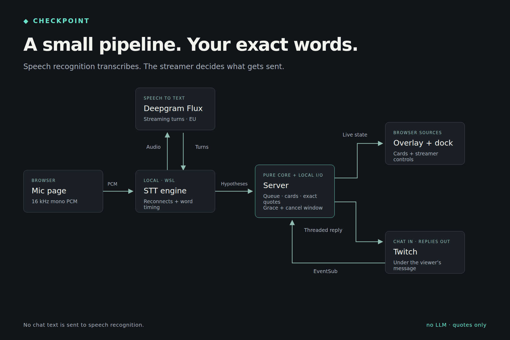

# Checkpoint

Answer Twitch chat out loud without leaving your work. Checkpoint saves viewer messages while you focus, opens them as cards at a checkpoint, and posts your answer as a threaded reply under each viewer's message.

Deepgram Flux transcribes your words live. There is no LLM, paraphrasing or transcript cleanup. You control every answer, can skip a card, and have five seconds to replace a pending quote with a plain receipt using **Cancel quote**. Repeated questions can receive an earlier answer with one click.

Built for the Codex x TwitchCon Hackathon. See [SPEC.md](SPEC.md) for behavior and acceptance criteria.

## Try it without keys

Supported environment: **Linux/WSL**, Bash, [uv](https://docs.astral.sh/uv/) and Python 3.12. On WSL, open the pages in Chrome on Windows. The launcher is verified on WSL; macOS is not a supported or verified target.

From a fresh clone of this repository, run:

```bash
uv sync --locked
./scripts/run_all.sh --demo
```

No `.env`, Twitch account, microphone or Deepgram key is needed. Demo mode disables Twitch even if credentials already exist in `.env`, and never starts the speech engine. It enables focus and adds three sample questions through the debug-chat endpoint.

1. Open [the dock](http://localhost:8200/dock/) and [the overlay](http://localhost:8200/overlay/) in separate tabs.
2. Click **Checkpoint** in the dock. Type an answer such as `VS Code, with a quiet theme.` into **Typed answer**, then click **Send typed answer**.
3. Watch the overlay stamp the card. Try **Skip** or **Cancel quote** on the remaining cards. Demo replies stay local and never reach Twitch.
4. Press **Ctrl-C** in the launcher terminal. It stops and reaps its server and engine processes; configured ports are released.

Add another local question while demo mode is running:

```bash
curl -fsS -X POST http://localhost:8200/dock/debug/chat \
  -H 'Content-Type: application/json' \
  --data '{"user":"rowan","text":"How do you organize your project?"}'
```

The default server port is 8200. To use another port, run `APP_PORT=8300 ./scripts/run_all.sh --demo` and change the URLs above to match. For a static preview without a server, open `/overlay/?demo=1` or `/dock/?demo=1` on a local static web server; `&step=N` freezes a demo beat.

## Full Twitch and speech setup

1. Install dependencies with `uv sync --locked`. Copy `.env.example` to `.env`, then fill in your values. Never commit `.env`, API keys or `data/tokens.json`.
2. Create your Twitch developer application with the broadcaster's account, choose the **Public** application/client type, and use its **Client ID**. The auth CLI uses the public-client device-code flow; no client secret is required. Configure the broadcaster and bot logins, and make the bot a moderator in the channel. The default bot is `checkpoint_bott` (two `t`s).
3. Set `DEEPGRAM_API_KEY`; the default region is `eu`, using Flux `flux-general-en`. Checkpoint does not send questions, chat text, keywords or prompts to Deepgram.
4. Authorize the bot:

   ```bash
   uv run python -m checkpoint.twitch_api.auth --account bot
   ```

   The CLI prints a code and activation URL. Open them in **your own incognito Chrome**, logged in as the configured bot. The token must have `user:read:chat` and `user:write:chat`. Stored tokens are checked against the configured login.
5. To use test viewers, configure and authorize the relevant aliases:

   ```bash
   uv run python -m checkpoint.twitch_api.auth --account test2
   uv run python -m checkpoint.twitch_api.auth --account test3
   ```

   Each viewer needs `user:write:chat`. The aliases `test`, `test2` and `test3` map to the logins in `.env`; user IDs are resolved at runtime. The broadcaster needs no token.
6. Before each rehearsal or recording, refresh every viewer account you will use **before starting the server**:

   ```bash
   uv run python -m checkpoint.twitch_api.auth --account test2 --refresh
   uv run python -m checkpoint.twitch_api.auth --account test3 --refresh
   ```

7. Start the server and engine:

   ```bash
   ./scripts/run_all.sh
   ```

   Extra arguments are passed unchanged to the mic engine. Save hypotheses for the WP7 rehearsal with:

   ```bash
   ./scripts/run_all.sh --save-hyps data/rehearsal-hyps.jsonl
   ```

8. Open [the mic page](http://localhost:8200/mic) in Chrome on Windows, select the microphone and connect. Open the dock, turn focus on, and collect chat. At a checkpoint, answer the card aloud. A finished turn starts the grace countdown; **Next** closes immediately, **Skip** sends nothing, and **Cancel quote** substitutes a plain receipt.

`APP_PORT` defaults to 8200 and `ENGINE_AUDIO_PORT` to 8766. Set them in `.env` or the environment; explicit environment values take precedence. The launcher checks required ports before starting and exits if either child stops. Ctrl-C or SIGTERM stops both children and their process groups. It never stops another application's port owner.

For OBS, add `http://localhost:8200/overlay/` as a **1920 × 1080 browser source** with a transparent background, and `http://localhost:8200/dock/` as a **400 px custom browser dock**. Update URLs if you override `APP_PORT`.

State is in memory and resets on restart. The token store is `data/tokens.json`; requested speech logs also stay under ignored `data/`. Debug chat is available only with server `--demo` or `CHECKPOINT_DEBUG=1`; injected replies are never sent to Twitch. `CHECKPOINT_DEBUG=1` alone does not disable normal Twitch intake, so use `--demo` for a fully local session.

## Timed chat and verification

Create a JSON file containing a timed list, for example:

```json
[
  {"account": "test2", "delay_s": 0, "text": "How long have you been coding?"},
  {"account": "test3", "delay_s": 2, "text": "Which editor do you use?"}
]
```

```bash
uv run python scripts/chat_script.py data/chat.json
```

The helper validates the complete file before network activity, waits each delay after the previous attempt finishes, and makes one attempt per entry. It prints only `success` or `failure`, never message text or tokens. It does not refresh tokens; use the refresh command first.

```bash
uv run pytest
uv run ruff check .
uv run playwright install chromium
uv run pytest -m browser
uv run python scripts/shoot.py overlay
uv run python scripts/shoot.py dock
```

Default tests use fakes and skip browser/live checks. Screenshot PNGs are saved under `data/shots/`; screenshot demos need no API keys. Use `scripts/shoot.py PAGE --live` to capture the running dock or overlay, or `scripts/shoot.py mic` for the mic page.

For a fully local recording rehearsal, the four-card runner starts its own
`--demo` server, injects timed chat and synthetic speech hypotheses, and drives
the dock controls. It uses real delays, including the three-minute earlier-answer
wait, and stops its server on exit:

```bash
uv run python scripts/dry_run.py --scenario docs/private/demo
```

The scenario directory is private and gitignored. Supply `part1.json` (four
timed messages), `part2.json` (one repeated question), and `replay.json`:

```json
{
  "users": {"test2": "river", "test3": "sage"},
  "answers": ["First answer.", "Second answer.", null, "Last answer."]
}
```

Answers correspond to the four cards: direct answer, question echo then answer,
Skip, and Next followed by Cancel quote. Chat entries use the same format as
`chat_script.py`, restricted to `test2`/`test3`. Output goes to
`data/shots/dry-run/`: per-beat overlay/dock screenshots, events, server log and
a pass/fail report. This checks application behavior with synthetic turns;
real-mic turn splitting still needs rehearsal. Demo sends remain suppressed,
so their success toast is covered separately with a fake sender in browser tests.

The [Devpost gallery](docs/gallery/README.md) contains three original 1920×1280
images and their local Playwright renderer.



```bash
uv run pytest -m live
```

Live checks require configured credentials and saved tokens. They contact Twitch and Deepgram; the WP6 check uses `test2` (`pixelmoth01`), sends `how long have you been coding?`, and replies with the exact typed answer `About ten years now, mostly Python.` as a threaded bot quote. Refresh the selected viewer token before running. Do not run live checks during a recording unless you want that chat visible.

## Relation to Minefield

Both projects are by the same author. Checkpoint adapts tested connection plumbing from the author's other hackathon entry; its product logic and presentation are new.

| Part | Relation to Minefield |
| --- | --- |
| Microphone page, device picker, resampler and reconnect behavior | Adapted and renamed for Checkpoint; shared teal theme |
| Deepgram streaming engine, heartbeat, Flux mapping and recorded-message fixtures | Adapted; Flux only, Checkpoint ports and turn-drain behavior |
| Twitch device-code auth, token storage/refresh, EventSub and Helix clients | Adapted; Checkpoint bot identity, deletion subscription and threaded replies |
| Queue, narrow noise filter, ordering, moderation and caps | New in Checkpoint |
| Card state machine, word-time attribution, echo detection, grace and cancellation | New in Checkpoint |
| Quote builder, earlier-answer matching and summary | New in Checkpoint |
| Server integration, overlay, dock, sounds and save-point visual identity | New in Checkpoint |
| Timed chat helper | Adapted from the development helper, with whole-file validation and one-attempt sends |

There are no Minefield game-core dependencies. See [AGENTS.md](AGENTS.md) for development rules and [web/assets/CREDITS.md](web/assets/CREDITS.md) for original asset credits.

Licensed under the [MIT License](LICENSE). Copyright 2026 furkankuscu08.
